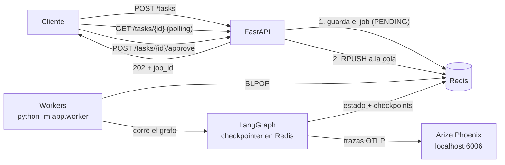
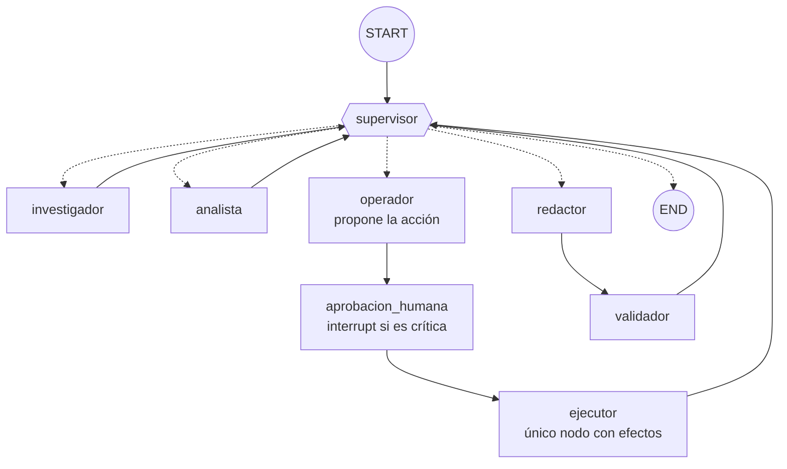

# API de producción del orquestador multi-agente (con monitoreo)

Pre-entrega 7 de AI Engineering (Coderhouse). Toma el orquestador multi-agente de la pre-entrega 6 (supervisor, investigador, analista, redactor y validador sobre **Colibrí**, el e-commerce ficticio del curso) y lo lleva a producción:

- **API con FastAPI que nunca bloquea:** `POST /tasks` guarda el pedido, lo encola en Redis y devuelve un `job_id` al instante. El agente corre en **workers** aparte, y el cliente consulta el estado por polling.
- **Redis** para todo el estado: la cola de trabajos, el estado de cada job (`PENDING`, `RUNNING`, `WAITING_APPROVAL`, `DONE`, `FAILED`) y los **checkpoints de LangGraph** (`AsyncRedisSaver`).
- **Human-in-the-loop:** si el pedido pide una acción con costo alto (mandar cupones de descuento a cientos de clientes), el grafo se **pausa** hasta que una persona la apruebe con `POST /tasks/{id}/approve`.
- **Observabilidad con Arize Phoenix:** cada ejecución del grafo es una traza con todos sus spans (nodos, llamadas al LLM y herramientas), con latencia, tokens y costo.

## Arquitectura



El grafo es el de la pre-entrega 6, más un especialista nuevo (el **operador**) y el tramo de aprobación:



## Endpoints

| Método | Ruta | Qué hace |
|---|---|---|
| `POST` | `/tasks` | Recibe `{"pedido": "..."}`, guarda el job y lo encola. Responde **202** con el `job_id` |
| `GET` | `/tasks/{job_id}` | Estado del job, recorrido del grafo, pregunta de aprobación o resultado. **404** si no existe |
| `POST` | `/tasks/{job_id}/approve` | `{"aprobado": true, "revisor": "...", "comentario": "..."}`. Reanuda el job. **409** si no está esperando aprobación |
| `GET` | `/tasks` | Últimos jobs |
| `GET` | `/health` | Redis, workers y modo |

La documentación interactiva queda en http://127.0.0.1:8000/docs.

## Cómo levantarlo

Requiere Python 3.12 y Docker.

```bash
git clone https://github.com/devrogerzen/codetest-AI-face7.git
cd codetest-AI-face7

# 1. Redis Stack y Phoenix
docker compose up -d

# 2. Entorno de Python
python -m venv .venv
.venv\Scripts\activate          # Windows (source .venv/bin/activate en Linux/Mac)
pip install -r requirements.txt
copy .env.example .env          # cp en Linux/Mac; completá la key de tu proveedor (o poné SIN_API=1)

# 3. La API (sin workers adentro) y los workers en otra terminal
set WORKERS=0                   # export WORKERS=0 en Linux/Mac
uvicorn app.main:app --port 8000
python -m app.worker --workers 3
```

Con `WORKERS=3` (el default) los workers corren dentro del proceso de la API: es más simple, pero el trabajo del grafo comparte el event loop con los endpoints. Separarlos es la arquitectura de la teoría: el worker es un proceso independiente que escala solo.

También se puede levantar todo en contenedores (API y workers incluidos):

```bash
docker compose --profile api up -d --build
```

- **Redis Stack** y no Redis "pelado": `langgraph-checkpoint-redis` necesita los módulos RedisJSON y RediSearch.
- **Phoenix 21** trae la autenticación activada por defecto. En el `docker-compose.yml` está apagada para el uso local (`PHOENIX_ENABLE_AUTH=false`); en un despliegue real se deja activada y se configura `PHOENIX_API_KEY`.

## Prueba de carga: 5 pedidos concurrentes

```bash
python scripts/prueba_carga.py --salida prueba_carga_gemini.json
```

Manda los 5 pedidos a la vez y hace polling. Cuando un job pide aprobación, decide como lo haría un revisor: aprueba lo que el pedido pidió y rechaza el cupón caro de los pedidos demorados y cualquier acción que nadie haya pedido. Al final calcula p50 y p95 y guarda el detalle en `resultados/`. Las dos corridas incluidas usan la API con `WORKERS=0` y 3 workers aparte.

### Con un LLM real: Gemini (plan gratis)

Es la corrida de las capturas de costo y latencia. El `.env`:

```
LLM_PROVIDER=google
GOOGLE_API_KEY=...                     # gratis en https://aistudio.google.com/apikey
GOOGLE_MODEL=gemini-3.1-flash-lite
SUPERVISOR_MODEL=gemini-3.5-flash-lite
LLM_RPM=14
LLM_MAX_RETRIES=10
```

El plan gratis permite 15 llamadas por minuto **por modelo**, y cada pedido hace unas 10. Por eso el supervisor usa otro modelo (con su propia cuota) y `LLM_RPM=14` hace que la app espere su turno antes de pasarse, en vez de chocar contra el 429.

| Pedido | Estado | Qué pasó | Tokens | Costo |
|---|---|---|---|---|
| ¿Cómo impactó el incidente de pagos en la opinión de los clientes? ¿Qué deberíamos hacer? | DONE | El modelo propuso por su cuenta un cupón del 20% ($424.320). Pausa → **rechazado**: el pedido no pedía ninguna compensación | 22.035 | US$ 0,0086 |
| Mandá un cupón del 10% a los clientes con cobro doble | DONE | Pausa ($212.160) → **aprobado** → se enviaron 312 cupones | 15.911 | US$ 0,0065 |
| ¿Qué opinan los clientes? Compará antes y después | DONE | Análisis completo, sin acción | 17.386 | US$ 0,0070 |
| Compensá con un cupón del 5% a los clientes con el pedido demorado | DONE | Pausa ($440.200, 1240 clientes) → **rechazado** → no se envió nada | 16.235 | US$ 0,0065 |
| Mandá un cupón del 2% a los clientes con cobro doble | DONE | $42.432, debajo del umbral: se aprobó solo, sin pausa | 15.655 | US$ 0,0064 |
| **Total** | | | **87.222** | **US$ 0,035** |

| Métrica | p50 | p95 |
|---|---|---|
| Respuesta de la API (`POST /tasks`) | 30,2 ms | 30,7 ms |
| Proceso del grafo, medido por el worker | 87,2 s | 147,7 s |
| Latencia de las trazas en Phoenix | 65,8 s | **115,0 s** |
| **Costo por ejecución** (Phoenix) | US$ 0,0065 | US$ 0,0086 |

- **La API sigue respondiendo en 30 ms:** el `POST` no espera al modelo.
- **La latencia del grafo la pone el plan gratis:** con 5 pedidos a la vez, cada llamada espera su lugar dentro de las 14 por minuto. Un pedido solo, sin competir por la cuota, tardó 18 s en las pruebas previas.
- **Phoenix calcula el costo con el precio de lista de cada modelo:** US$ 0,25 y US$ 1,50 por millón de tokens de entrada y de salida para `gemini-3.1-flash-lite`, y US$ 0,30 y US$ 2,50 para `gemini-3.5-flash-lite`. El plan gratis no cobra; es lo que costaría la corrida con facturación.
- El detalle está en `resultados/prueba_carga_gemini.json`.

### Capturas del panel (`screenshots/`)

| Captura | Qué muestra |
|---|---|
| `04_trazas_gemini.jpg` | Las 8 trazas de la corrida con Gemini (5 ejecuciones y 3 reanudaciones después de una decisión humana), todas OK, con la latencia, los tokens y el costo de cada una |
| `05_costo_por_ejecucion_gemini.jpg` | El **costo de una ejecución** desglosado: US$ 0,0039 de entrada + US$ 0,0024 de salida = **US$ 0,0064** (el pedido del cupón del 2%) |
| `06_latencia_p95_y_costo_gemini.jpg` | Pestaña *Metrics*: percentiles de latencia (**p95 = 114,97 s**), costo estimado de la corrida por entrada y salida, y los dos modelos ordenados por costo |
| `01_trazas.jpg` | Corrida con los modelos simulados: 7 trazas, todas OK |
| `02_latencia_p95.jpg` | Corrida simulada: percentiles de latencia (p95 = 1,18 s). El panel de costo queda vacío porque no hay tokens |
| `03_traza_aprobacion_humana.jpg` | Una traza abierta: supervisor → investigador → operador → aprobacion_humana → ejecutor → redactor → validador, con la latencia de cada span |

**Lectura del panel (corrida con Gemini):**
- **El supervisor es el que más tokens consume:** 38.353 de 87.222 (44%) en 24 llamadas. Decide 4 o 5 veces por pedido y cada vez recibe el estado completo (hallazgos, métricas y aportes). Es el primer lugar para ahorrar: pasarle un resumen del estado en vez del estado entero.
- **Le siguen** el investigador (25%), el analista (14%), el redactor (12%) y el operador (5%).
- **La latencia se concentra en el investigador:** 48 s por ejecución en promedio, porque encadena varias búsquedas y cada llamada espera su turno dentro del límite del plan gratis.
- **Entrada contra salida:** el 92% de los tokens son de entrada, pero la salida es entre 6 y 8 veces más cara por token. Termina siendo el 38% del costo (US$ 0,0132 de US$ 0,035).
- **Una aprobación, dos trazas:** los jobs con aprobación humana aparecen como dos trazas (antes y después de la pausa) unidas por la misma sesión, porque el `session.id` de cada traza es el `job_id`.

### Lo que apareció recién con un LLM real

| Problema | Causa | Arreglo |
|---|---|---|
| El segundo turno de cada agente con herramientas fallaba con un 400 | Gemini 3 exige que se le devuelva la *thought signature* de cada llamada a una herramienta, y el cliente de OpenAI (por el endpoint compatible) la descarta | Proveedor `google` con `langchain-google-genai`, que la maneja de forma nativa |
| 2 de los 5 pedidos terminaron en `FAILED` por un 429 | El plan gratis permite 15 llamadas por minuto por modelo, y 3 workers en paralelo hacen más de 30 | `LLM_RPM`: un limitador por modelo, compartido por todos los agentes del proceso. El supervisor va en otro modelo, con su propia cuota, y hay más reintentos (`LLM_MAX_RETRIES`) |
| El cupón para los pedidos demorados se cotizó para el segmento de cobro doble | El operador siguió la instrucción del supervisor aunque contradecía el pedido | El prompt del operador aclara que el segmento sale del pedido del usuario |
| Después de un rechazo, el supervisor volvió a proponer la misma acción | El LLM leyó el comentario del revisor como un pedido de revisión | Regla fija en el supervisor: una acción que ya tiene decisión humana no se vuelve a proponer. Lo cubre un chequeo nuevo en `prueba_sin_api.py` |

El primer pedido no pide ninguna acción, y aun así el modelo propuso un cupón del 20%. Es justo el caso para el que existe la pausa humana: el agente puede equivocarse en qué hacer, pero no puede hacerlo sin que una persona lo apruebe.

### Con los modelos simulados (sin key)

Los mismos 5 pedidos con `SIN_API=1`, en `resultados/prueba_carga.json`:

| Pedido | Estado | Qué pasó |
|---|---|---|
| ¿Cómo impactó el incidente de pagos en la opinión de los clientes? | DONE | Análisis completo, sin acción |
| Mandá un cupón del 10% a los clientes con cobro doble | DONE | Pausa en `WAITING_APPROVAL` ($212.160) → **aprobado** → se enviaron 312 cupones |
| ¿Qué opinan los clientes? Compará antes y después | DONE | Análisis completo, sin acción |
| Compensá con un cupón del 5% a los clientes con el pedido demorado | DONE | Pausa ($440.200) → **rechazado** → no se envió nada |
| Mandá un cupón del 2% a los clientes con cobro doble | DONE | $42.432, debajo del umbral: se aprobó solo, sin pausa |

| Métrica | p50 | p95 |
|---|---|---|
| Respuesta de la API (`POST /tasks`) | 28 ms | 30 ms |
| Proceso del grafo, medido por el worker | 0,88 s | 1,21 s |
| Latencia de las trazas en Phoenix | 0,46 s | **1,18 s** |

La misma prueba con todo en contenedores (`docker compose --profile api up -d`) también termina con los 5 en `DONE`: `POST` p50 26 ms y p95 27 ms, proceso p50 0,83 s y p95 1,04 s. `resultados/prueba_carga.json` es esa corrida.

`scripts/prueba_carga.py` usa `127.0.0.1` y no `localhost`: en Windows, `localhost` prueba primero IPv6 y cada conexión nueva tarda unos 300 ms en caer a IPv4. Con `localhost` el `POST` parece tardar 300 ms, pero es del cliente, no de la API.

Sin LLM, el grafo tarda alrededor de un segundo y la latencia se concentra en el investigador, que busca en la documentación y trae las reseñas (135 a 280 ms por ejecución). Los modelos simulados no informan tokens, así que en esta corrida el panel de costo queda vacío: el costo sale de la corrida con Gemini.

## Human-in-the-loop

- **El operador solo propone.** `cotizar_cupones` calcula cuántos clientes y cuánto cuesta (clientes × ticket promedio × porcentaje) y deja la propuesta en `state["accion"]`. No envía nada.
- **`aprobacion_humana` decide si es crítica.** Si el costo supera `UMBRAL_APROBACION` (50.000), llama a `interrupt()`: el grafo se detiene y el estado queda en Redis bajo `thread_id = job_id`. El worker marca el job como `WAITING_APPROVAL`, con la pregunta y el costo, y queda libre para atender otros pedidos.
- **La aprobación es asíncrona.** `POST /tasks/{id}/approve` no corre nada: encola un mensaje de reanudación. Un worker lo toma y llama a `graph.astream(Command(resume=decisión))` sobre el mismo hilo.
- **El efecto está en un nodo aparte (`ejecutor`).** Al reanudar, LangGraph vuelve a ejecutar `aprobacion_humana` desde el principio. Si el envío estuviera antes del `interrupt()`, se mandaría dos veces.
- **Las acciones baratas no frenan el flujo:** se aprueban solas y el informe lo aclara.
- **La decisión humana es final.** Una vez que una persona aprobó o rechazó una acción, el supervisor no puede volver a mandarla al operador en el mismo job: una regla fija lo deriva al redactor, aunque el LLM insista.

### Prueba de reinicio (el estado sobrevive en Redis)

```bash
python scripts/prueba_reinicio.py crear      # deja un job en WAITING_APPROVAL
# ... Ctrl+C a la API y a los workers, y volver a levantarlos ...
python scripts/prueba_reinicio.py aprobar    # lo aprueba y espera DONE
```

Salida real:

```
Job 434c4d00-...: WAITING_APPROVAL
Pregunta: ¿Aprobás esta acción? Enviar un cupón del 10% a 312 clientes ... Costo estimado: $212.160.
(reinicio de la API y los workers)
Después del reinicio, el job 434c4d00-... está en: WAITING_APPROVAL
Resultado: DONE · Se enviaron 312 cupones del 10% (costo estimado $212.160), aprobados por Roger.
Recorrido: supervisor -> investigador -> supervisor -> operador -> aprobacion_humana -> ejecutor -> supervisor -> redactor -> validador -> supervisor
```

## Robustez

- **El estado se guarda antes de encolar.** Si el worker fuera más rápido que la escritura, el cliente recibiría un 404 por un job que sí existe.
- **Todo error termina en `FAILED`.** El worker captura cualquier excepción del agente y guarda el error en Redis, así el cliente nunca queda haciendo polling para siempre. El worker sigue atendiendo los pedidos siguientes.
- **Los checkpoints se leen como objetos, no como dicts.** El serializador de Redis solo reconstruye clases de una lista permitida (por seguridad). Por eso `app/worker.py` le pasa la lista de los modelos del estado (`PERMITIDOS_JSON` en `app/state.py`). Sin eso, al reanudar un hilo los `Informe`, `Hallazgo`, etc. volvían como diccionarios y el job fallaba.
- **Validación en la puerta:** el pedido se valida con Pydantic (entre 10 y 2000 caracteres), igual que la decisión humana.
- **Los límites del proveedor se respetan del lado de la app.** `LLM_RPM` pone un limitador por modelo, compartido por todos los agentes del proceso, y `LLM_MAX_RETRIES` cubre los 429 y 5xx que igual lleguen.
- **Las trazas incluyen solo el agente.** Phoenix se registra sin proveedor global de OpenTelemetry e instrumenta solo LangChain/LangGraph. Si no, FastAPI mandaría un span por cada GET de polling, y esas trazas sueltas bajarían el p50 del panel a unos milisegundos que no son del agente.
- **Contexto de cada traza:** `session_id` = job, `prompt_template_version` y metadata (tipo de mensaje, worker), con `using_attributes` de OpenInference. Si cambia un prompt, se ve en Phoenix qué versión corrió.

## Estructura

```
app/
  main.py            # FastAPI: POST /tasks, GET /tasks/{id}, POST /tasks/{id}/approve
  worker.py          # Workers: consumen la cola, corren el grafo, actualizan el estado (y python -m app.worker)
  jobs.py            # Estado de los jobs (hash en Redis) y la cola (lista en Redis)
  graph.py           # El orquestador de la pre-entrega 6 + operador + aprobación + checkpointer
  hitl.py            # Nodo de aprobación humana (interrupt) y nodo ejecutor
  observability.py   # Phoenix: exportador OTLP + instrumentación de LangChain/LangGraph
  config.py          # Variables de entorno, umbral, límites y creación de los LLM (OpenAI, Anthropic o Gemini)
  state.py           # Estado compartido y contratos Pydantic
  agents/            # supervisor, investigador, analista, operador, redactor, validador
  datos.py           # Documentación (BM25), reseñas y léxico de sentimiento
  modelo_simulado.py # Modelos de reglas para correr sin API key
scripts/
  prueba_carga.py    # Los 5 pedidos concurrentes, con aprobación y percentiles
  prueba_reinicio.py # Pausar, reiniciar y aprobar
prueba_sin_api.py    # 26 chequeos sin Docker, sin Redis y sin key
data/                # Base de conocimiento de Colibrí, reseñas y segmentos de clientes
screenshots/         # Capturas de Phoenix
resultados/          # Salida de las pruebas (JSON)
docker-compose.yml   # Redis Stack + Phoenix (+ API y worker con --profile api)
Dockerfile
```

## Pruebas sin infraestructura

```bash
python prueba_sin_api.py
```

Corre la API completa (endpoints, workers, grafo y aprobación humana) contra un Redis falso en memoria (`fakeredis`) y los modelos simulados. El checkpointer usa **el mismo serializador que Redis**, así un estado que no sobrevive a Redis también falla acá. Son 26 chequeos:
- **Serialización:** sin la lista permitida el estado vuelve como dict; con la lista, como modelo.
- **Endpoints:** 202 inmediato, el job existe antes de encolarse, 422 por validación, 404, 409.
- **Grafo:** recorrido completo e informe validado.
- **Human-in-the-loop:** pausa con la pregunta y el costo, nada ejecutado antes de aprobar, reanudación, ejecución única, rechazo, aprobación automática debajo del umbral, y una acción rechazada que no se vuelve a proponer aunque el supervisor insista.
- **Concurrencia:** 5 pedidos a la vez repartidos entre los workers.
- **Fallas:** un LLM caído termina en `FAILED`, los workers siguen vivos y otra instancia de la API retoma un job pausado.

## Variables de entorno

| Variable | Default | Descripción |
|---|---|---|
| `REDIS_URL` | `redis://localhost:6379` | Redis Stack |
| `PHOENIX_COLLECTOR_ENDPOINT` | `http://localhost:6006/v1/traces` | Colector OTLP de Phoenix |
| `PHOENIX_PROJECT_NAME` | `colibri-orquestador` | Proyecto en Phoenix |
| `TRAZAS` | `1` | `0` para apagar las trazas |
| `WORKERS` | `3` | Workers dentro de la API; `0` si corren aparte |
| `UMBRAL_APROBACION` | `50000` | Costo (pesos) a partir del cual una acción necesita aprobación humana |
| `SIN_API` | `0` | `1` = modelos simulados, sin key |
| `LLM_PROVIDER` | `openai` | `openai`, `anthropic` o `google` |
| `OPENAI_API_KEY` / `OPENAI_MODEL` / `OPENAI_BASE_URL` | — / `gpt-4o-mini` / — | Para `openai` |
| `ANTHROPIC_API_KEY` / `ANTHROPIC_MODEL` | — / `claude-haiku-4-5` | Para `anthropic` |
| `GOOGLE_API_KEY` / `GOOGLE_MODEL` | — / `gemini-3.1-flash-lite` | Para `google` (Gemini; la key es gratis en AI Studio) |
| `SUPERVISOR_MODEL` | el mismo modelo | Otro modelo solo para el supervisor |
| `LLM_RPM` | `0` | Tope de llamadas por minuto a cada modelo (`0` = sin tope). Con el plan gratis de Gemini: `14` |
| `LLM_MAX_RETRIES` | `2` | Reintentos ante 429 y 5xx |
