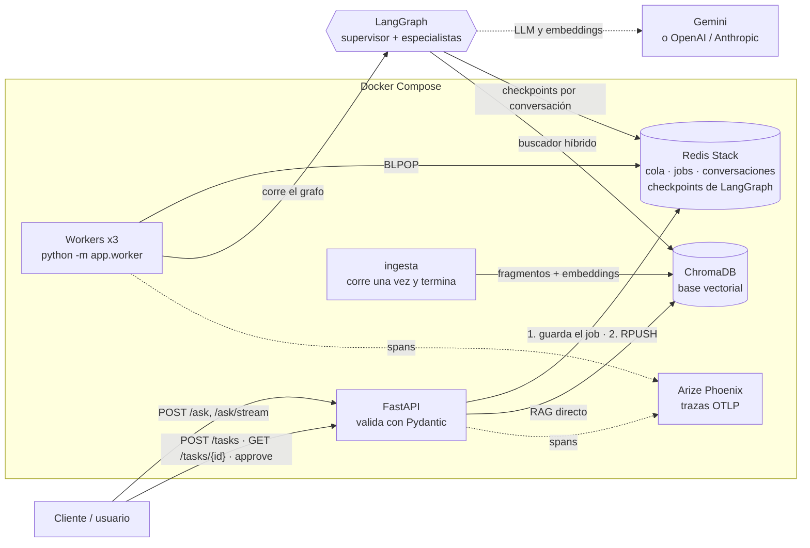
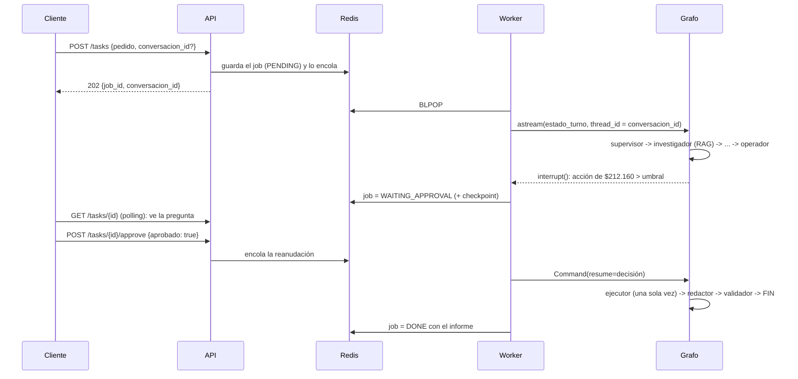
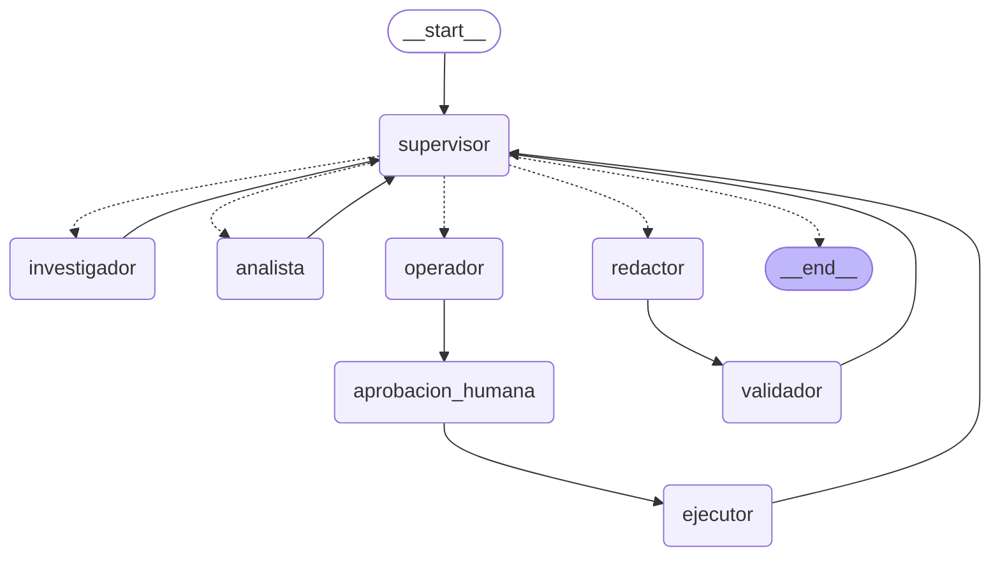
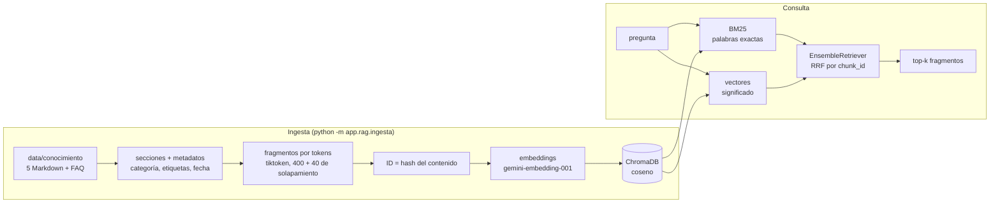
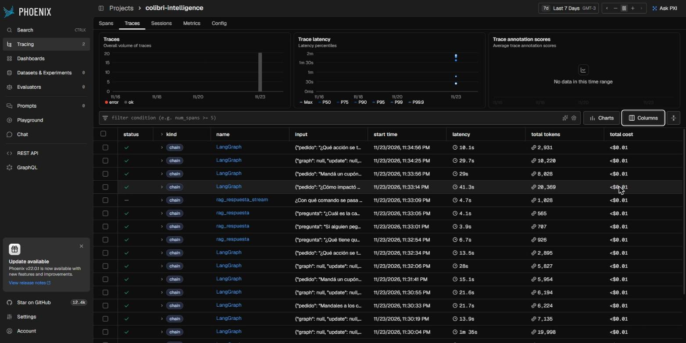
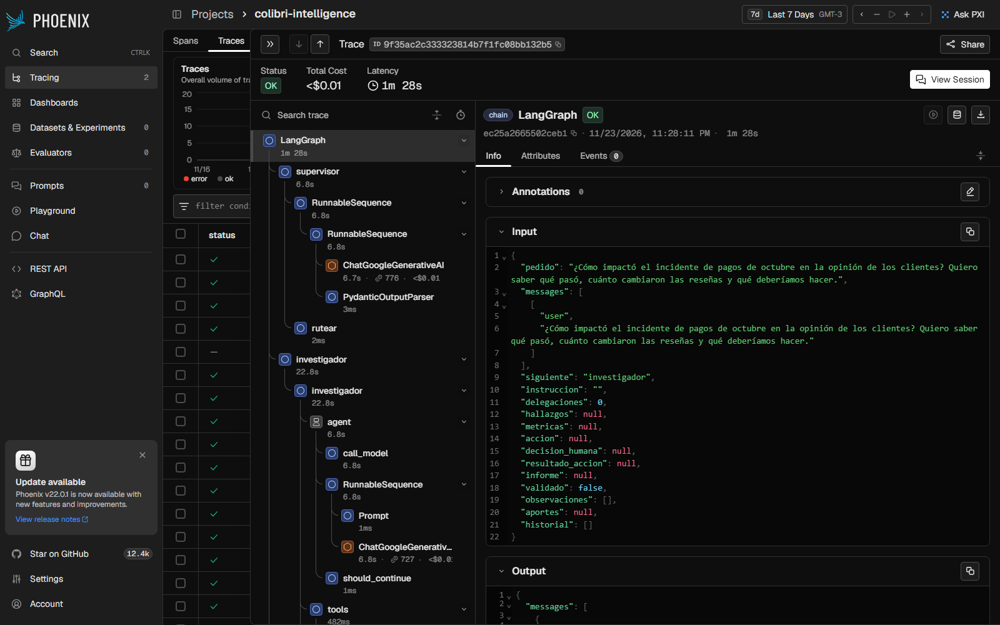
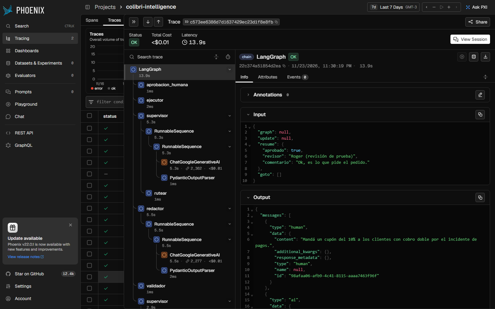
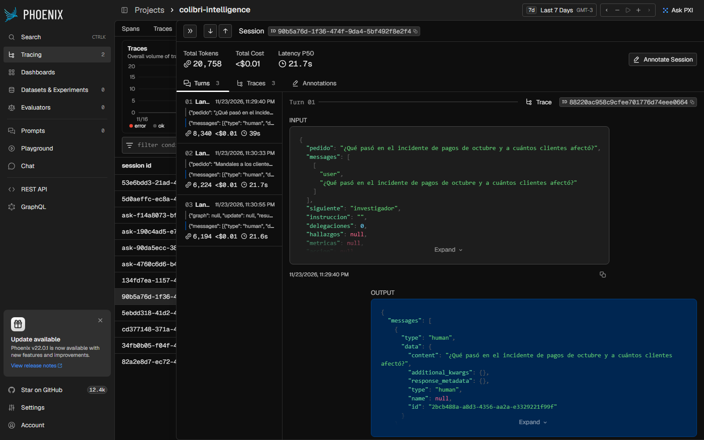
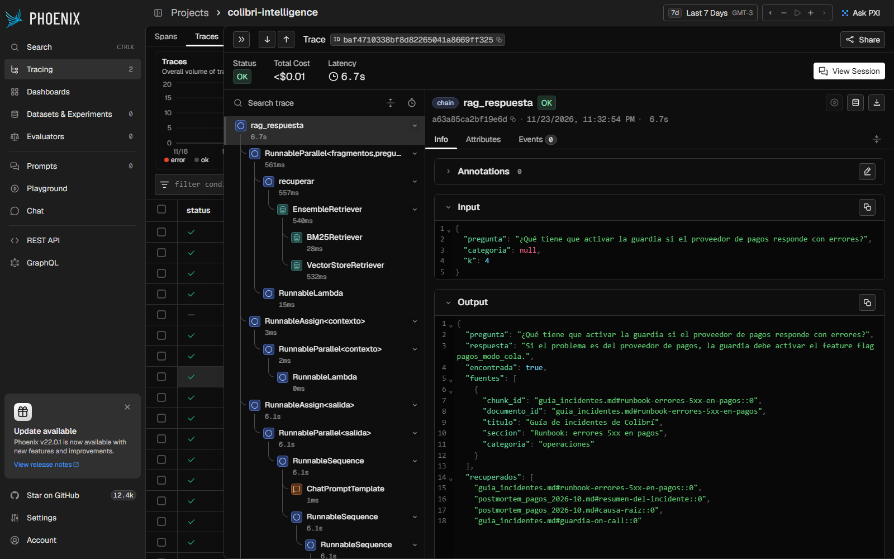
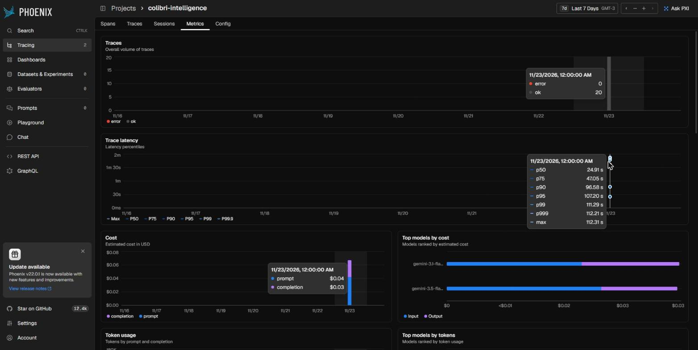

# Colibrí Intelligence

Entrega final de AI Engineering (Coderhouse): un sistema de IA de grado de producción que junta las siete pre-entregas en un solo repositorio.

**El problema.** Colibrí es el e-commerce ficticio del curso. Su equipo necesita dos cosas: preguntarle a la documentación interna (arquitectura, runbooks, postmortems, seguridad, despliegue) y resolver tareas de varios pasos sobre ella. Por ejemplo: *"¿cómo impactó el incidente de pagos de octubre en la opinión de los clientes y qué hacemos?"* o *"mandales a los clientes con cobro doble el cupón que recomienda el postmortem"*.

**Qué hace el sistema.**

- **Conocimiento específico (RAG).** Una base vectorial ChromaDB con la documentación fragmentada por tokens y con metadatos. La búsqueda es híbrida: BM25 + vectores, fusionados con RRF. Las fuentes se verifican y responde *"No lo sé."* cuando la base no alcanza.
- **Razonamiento de varios pasos (agentes).** Un **supervisor** reparte el trabajo entre especialistas (investigador, analista, operador y redactor). Un **validador determinista** revisa el informe antes de cerrar.
- **API profesional.** FastAPI con validación Pydantic en todas las entradas y salidas. Tiene respuestas directas (`/ask`, con streaming SSE) y tareas largas en una cola de Redis atendida por workers, con conversaciones con memoria y aprobación humana para lo caro.
- **Trazabilidad completa.** Cada nodo, llamada al LLM, búsqueda y herramienta queda como span en **Arize Phoenix**, con latencia, tokens y costo.
- **Persistencia.** Los checkpoints de LangGraph viven en Redis (`AsyncRedisSaver`). Una conversación o una acción pausada sobreviven a un reinicio del servidor.

Todo corre con **una sola instrucción** (`./run.sh` o `docker compose up -d --build`). Todo es asíncrono y está probado con **46 tests** que no necesitan ni Docker ni key. Las corridas reales se hicieron con el **plan gratis de Gemini**.

---

## Índice

1. [La consigna, punto por punto](#la-consigna-punto-por-punto)
2. [Arquitectura](#arquitectura)
3. [El grafo de agentes](#el-grafo-de-agentes)
4. [El RAG](#el-rag)
5. [Conversaciones y persistencia](#conversaciones-y-persistencia)
6. [Aprobación humana](#aprobación-humana)
7. [Observabilidad, costo y latencia](#observabilidad-costo-y-latencia)
8. [Cómo levantarlo](#cómo-levantarlo)
9. [La API](#la-api)
10. [Pruebas](#pruebas)
11. [Configuración](#configuración)
12. [Estructura del repositorio](#estructura-del-repositorio)
13. [Decisiones técnicas](#decisiones-técnicas)
14. [Limitaciones y próximos pasos](#limitaciones-y-próximos-pasos)

---

## La consigna, punto por punto

| Pide la consigna | Dónde está |
|---|---|
| Acceso a conocimiento específico (RAG) | `app/rag/`: ingesta incremental en ChromaDB, búsqueda híbrida BM25 + vectores con RRF, filtros por metadatos, defensas contra la alucinación y evaluación con golden set ([El RAG](#el-rag)) |
| Razonamiento multi-paso (agentes con Supervisor) | `app/agents/` y `app/graph.py`: supervisor con salida estructurada, especialistas ReAct y validador determinista ([El grafo](#el-grafo-de-agentes)) |
| Interfaz de API profesional y documentada | `app/main.py`: FastAPI con OpenAPI en `/docs`, códigos HTTP correctos, API key opcional ([La API](#la-api)) |
| Trazabilidad completa | `app/observability.py`: Arize Phoenix vía OpenInference, una sesión por conversación, más las capturas de `screenshots/` ([Observabilidad](#observabilidad-costo-y-latencia)) |
| Integrar las pre-entregas de los módulos 6 y 7 en una estructura unificada | El grafo de la PE6 y la API de la PE7 son la base. Se suman el RAG de la PE3/PE4 y el cliente multi-proveedor de la PE1/PE2 (`app/config.py`). El historial de commits muestra el paso a paso |
| Todo asíncrono (`async/await`) | Endpoints, workers, nodos del grafo, herramientas, búsqueda y checkpointer son `async`. Lo único síncrono (Chroma, BM25) corre en hilos con `asyncio.to_thread` o en el executor de LangChain, nunca en el event loop. HTTP con `httpx`, nunca `requests` |
| Checkpointer de LangGraph para no perder conversaciones al reiniciar | `AsyncRedisSaver` con `thread_id = conversacion_id`. `scripts/prueba_reinicio.py` lo demuestra con `docker compose restart` ([Conversaciones](#conversaciones-y-persistencia)) |
| Pydantic en entradas y salidas de la API y de las herramientas | Cada endpoint tiene modelo de entrada y de salida. Cada herramienta tiene `args_schema`. Los agentes devuelven salida estructurada (`DecisionSupervisor`, `Informe`, `RespuestaLLM`) |
| Al menos 5 pruebas con trazas visibles en Phoenix | `scripts/pruebas_sistema.py`: 9 ejecuciones reales con Gemini, con sus capturas ([Pruebas](#pruebas)) |
| README con diagrama de flujo del grafo de agentes | [El grafo de agentes](#el-grafo-de-agentes), generado por LangGraph (`scripts/diagrama_grafo.py`) |
| Despliegue local con una sola instrucción | `./run.sh` o `docker compose up -d --build` |
| Sin hard-coding de modelos ni índices | Modelos, colección, URLs, límites y pesos salen de variables de entorno ([Configuración](#configuración)) |
| Python 3.12+, dependencias y variables de entorno | `pyproject.toml` (rangos) y `requirements.txt` (versiones fijas, las probadas), con `.env.example` documentado |

**Lo que pidieron las devoluciones de las pre-entregas, y cómo quedó:**

- La validación pasó de un script (`prueba_sin_api.py`) a una **suite pytest registrada en `pyproject.toml`**.
- Hay un **notebook de demo ejecutado** con el LLM real: [`notebooks/demo.ipynb`](notebooks/demo.ipynb).
- El **historial de commits** cuenta el desarrollo etapa por etapa.
- Las métricas del RAG se midieron con **embeddings reales** y con **experimentos de pesos y tamaño de fragmento**.

---

## Arquitectura



| Capa | Qué hace | De qué módulo viene |
|---|---|---|
| `app/config.py` | Factory de LLM y embeddings por proveedor, reintentos, timeouts y límites por minuto. Todo desde `.env` | M1 (cliente robusto y asíncrono) y M2 |
| `app/rag/` | Carga, fragmentación, ingesta incremental, base vectorial, búsqueda híbrida, cadena LCEL de respuesta, evaluación | M3 (ChromaDB, chunking) y M4 (híbrido, metadatos, métricas) |
| `app/agents/`, `app/graph.py`, `app/state.py` | Supervisor, especialistas ReAct, validador, estado compartido con reducers y aislamiento de escritura | M5 (LangGraph, tool calling) y M6 (multi-agente) |
| `app/main.py`, `app/jobs.py`, `app/worker.py`, `app/hitl.py`, `app/observability.py` | API, cola, workers, aprobación humana y trazas | M7 (producción) |

**Por qué dos caminos.** Una pregunta puntual ("¿qué flag se activa si falla el proveedor de pagos?") se responde en segundos con el RAG directo (`/ask`): no hace falta un equipo de agentes. Una tarea de varios pasos (investigar, comparar reseñas, proponer una compensación, escribir un informe) tarda de uno a dos minutos con el plan gratis. Por eso va a una cola: la API responde **202** al instante y el cliente consulta el estado.

### Cómo viaja un pedido con aprobación humana



---

## El grafo de agentes

Diagrama generado por LangGraph a partir del grafo compilado (`python scripts/diagrama_grafo.py`, guardado en `docs/grafo.mmd`):



Las líneas punteadas son las **aristas condicionales** del supervisor. Las continuas son fijas: todo especialista vuelve al supervisor, y el operador siempre pasa por la aprobación y el ejecutor.

| Nodo | Qué hace | Escribe en el estado |
|---|---|---|
| **supervisor** | Router: lee un resumen del estado y la conversación previa, y decide quién sigue con una rúbrica de 7 pasos. Usa salida estructurada (`DecisionSupervisor`, con un `Literal` de destinos). No investiga, no calcula y no redacta. Tiene un tope de delegaciones y cuatro guardas en código: no se cierra sin informe validado, una acción ya decidida no se vuelve a proponer, si el pedido no pide una acción el operador no interviene (mínimo privilegio) y un porcentaje que no sale del pedido ni de lo investigado manda a investigar antes de cotizar | `siguiente`, `instruccion`, `delegaciones`, `historial` (al cerrar) |
| **investigador** | Agente ReAct con dos herramientas: `buscar_documentacion` (el **RAG híbrido**, con filtro opcional por categoría) y `buscar_resenas` (por período) | `hallazgos` (con el `documento_id` exacto) |
| **analista** | Agente ReAct que calcula sobre las reseñas: sentimiento, estadísticas, comparación antes/después | `metricas` |
| **operador** | Cotiza una acción sobre clientes (cupones). Solo propone, no ejecuta | `accion` |
| **aprobacion_humana** | Si la acción cuesta más que el umbral, pausa el grafo con `interrupt()`. Si cuesta menos, la aprueba sola | `decision_humana` |
| **ejecutor** | El único nodo con efectos. Corre una sola vez, después de la decisión | `resultado_accion` |
| **redactor** | Escribe el `Informe` (salida estructurada) solo con lo que hay en el estado | `informe` |
| **validador** | Sin LLM: chequea que cada fuente exista, que cada métrica citada exista y que cada número salga de un hallazgo o una métrica. Si falla, el supervisor manda a corregir | `validado`, `observaciones` |

**Aislamiento de escritura.** Cada nodo es dueño de su parte del estado (`app/state.py`). Las listas usan un reducer que acumula sin pisar lo de otro nodo y que se vacía al empezar un turno nuevo de la conversación. Cada nodo deja además un `Aporte`: el registro de quién hizo qué en cada paso, que se ve en el resultado del job.

---

## El RAG



- **Fragmentación.** Cada sección (`##`) es un documento con un `documento_id` estable (por ejemplo `guia_incidentes.md#runbook-errores-5xx-en-pagos`). Se corta por tokens con `RecursiveCharacterTextSplitter.from_tiktoken_encoder`. Cada fragmento empieza con `Título > Sección`: así un fragmento suelto no pierde de qué habla.
- **Ingesta incremental e idempotente.** El ID de cada fragmento es el hash de documento, posición y texto. La ingesta sube solo lo nuevo y borra lo obsoleto. La segunda corrida no gasta ningún embedding. Hay un guarda: si la colección se indexó con otro modelo de embeddings, se niega a abrirla.
- **Búsqueda híbrida.** BM25 encuentra términos exactos (`pagos_modo_cola`, "429", `colibri-ops redis failover`). Los vectores encuentran paráfrasis ("contraseña" → "secretos filtrados"). `EnsembleRetriever` las fusiona con Reciprocal Rank Fusion, y `id_key="chunk_id"` cuenta una sola vez un fragmento que encontraron los dos.
- **Metadatos.** Categoría, etiquetas, fecha, sección y tipo. El investigador puede filtrar por categoría (`postmortems`, `operaciones`, `seguridad`...): en Chroma el filtro se aplica dentro de la búsqueda.
- **Tres defensas contra la alucinación** (`app/rag/respuestas.py`):
  1. un prompt "filtro de veracidad" que obliga a responder solo con el contexto o decir *"No lo sé."*;
  2. cada fuente que cita el modelo se compara con lo que se recuperó de verdad, y las inventadas se descartan;
  3. si el modelo dice que encontró la respuesta pero no queda ninguna fuente válida, la respuesta es *"No lo sé."*.

### Evaluación con golden set

`data/golden_set.json` tiene 15 preguntas: las 10 de la pre-entrega 4 y 5 nuevas sobre el postmortem. Varias son trampas: términos técnicos exactos, paráfrasis y respuestas dentro de una tabla. `python scripts/evaluar_rag.py` mide Recall@4, Precision@4 y MRR por modo, peso de la fusión y tamaño de fragmento. Cada combinación se indexa en una base temporal y cada texto se embebe una sola vez.

Resultado con **embeddings reales** (`gemini-embedding-001`, k = 4), guardado en `resultados/evaluacion_rag.json`:

| Fragmento | Modo | Peso BM25 | Recall@4 | Precision@4 | MRR |
|---|---|---|---|---|---|
| 400 tokens (35 fragmentos) | BM25 | – | 0,967 | 0,317 | 0,967 |
| 400 | vectorial | – | 0,967 | 0,317 | 0,922 |
| 400 | híbrido | 0,3 | 0,967 | 0,317 | 0,933 |
| **400** | **híbrido** | **0,5** | **0,967** | **0,317** | **0,967** |
| 400 | híbrido | 0,7 | 0,967 | 0,317 | 0,967 |
| 120 tokens (65 fragmentos) | BM25 | – | 0,933 | 0,300 | 0,967 |
| 120 | vectorial | – | 0,933 | 0,300 | 0,900 |
| 120 | híbrido | 0,3 | 0,967 | 0,317 | 0,900 |
| 120 | híbrido | 0,5 | 0,967 | 0,317 | 0,967 |
| 120 | híbrido | 0,7 | 0,967 | 0,317 | 0,967 |

Cómo se lee:

- **El híbrido con peso 0,5 (la configuración del sistema) empata lo mejor de cada buscador en las dos granularidades.** Los vectores solos ordenan peor (MRR 0,922 y 0,900). BM25 solo pierde Recall con fragmentos chicos, porque una paráfrasis no comparte palabras con el fragmento.
- **Precision@4 no puede pasar de ~0,32 en este golden set:** la mayoría de las preguntas tiene un solo documento relevante, así que con 4 resultados el máximo es 0,25 (0,5 si son dos). El dato que importa es el Recall: lo que no se recupera, el modelo no lo ve.
- **Fragmentos más chicos no ayudan acá:** las secciones ya son cortas, y cortarlas en 120 tokens duplica los fragmentos sin mejorar nada.
- **La única pregunta que no trae todos sus documentos** es "¿Cuánto tarda en actualizarse un precio en la tienda?". Trae la entrada del FAQ, que tiene la respuesta, pero no la sección de arquitectura que habla de la caché.

Con embeddings locales (`SIN_API=1`), la misma evaluación da Recall 0,933 y MRR 0,967 en el híbrido. Sirve para probar el mecanismo; las métricas reales son las de la tabla.

---

## Conversaciones y persistencia

- **El `thread_id` del checkpointer es la conversación.** `POST /tasks` acepta un `conversacion_id` opcional. Sin él, se crea una conversación nueva. Con él, el pedido es un turno más de la misma conversación.
- **Qué se acumula y qué no.** Cada turno arranca con `estado_turno()`, que vacía lo propio del turno (hallazgos, métricas, informe, aportes) y deja `historial` y `messages`, que son la memoria. Al cerrar, el supervisor agrega un `Turno` (pedido, título, resumen y acción) al historial. En el turno siguiente, el supervisor y el redactor ven los últimos tres turnos.
- **Un pedido a la vez por conversación.** Se toma con `SET NX` en Redis: un segundo pedido mientras el primero corre (o espera aprobación) recibe **409** con el job activo.
- **Sobrevive a un reinicio.** Los checkpoints están en Redis (`AsyncRedisSaver`), no en la memoria del proceso. `GET /conversations/{id}` muestra los turnos leídos del checkpointer. `scripts/prueba_reinicio.py` pausa una acción, reinicia la API y los workers con `docker compose restart`, la aprueba y después manda un segundo turno que se apoya en el primero.
- **En Phoenix**, el `session.id` de cada traza es el `conversacion_id`: los turnos de una conversación quedan agrupados en la misma sesión.

Resultado de `python scripts/prueba_reinicio.py` (`resultados/prueba_reinicio.json`):

1. Un pedido de cupón del 10% queda en `WAITING_APPROVAL` ($212.160 > umbral).
2. `docker compose restart api worker`: los procesos se reinician y la memoria de los procesos se pierde.
3. Después del reinicio, el job sigue en `WAITING_APPROVAL`. Se aprueba y termina en `DONE`: *"Se enviaron 312 cupones del 10% (costo estimado $212.160), aprobados por Roger."*
4. Un segundo pedido en la misma conversación (*"¿Qué acción se tomó con los clientes con cobro doble y cuánto costó?"*) se responde con la memoria del primer turno: *"se compensó a los 312 clientes afectados mediante el envío de cupones de descuento. Esta acción tuvo un costo total estimado de $212.160"*. `GET /conversations/{id}` muestra los 2 turnos.

---

## Aprobación humana

Una acción con efectos en el mundo real (mandar cupones a cientos de clientes) no se ejecuta sin control:

- el **operador** solo la propone y la cotiza (destinatarios × ticket promedio × porcentaje);
- **aprobacion_humana**: si cuesta más que `UMBRAL_APROBACION` ($50.000), llama a `interrupt()` y el job queda en `WAITING_APPROVAL` con la pregunta y el costo. Si cuesta menos, se aprueba sola: frenar todo mataría la ventaja de automatizar;
- `POST /tasks/{id}/approve` encola la decisión y un worker reanuda el mismo hilo con `Command(resume=...)`;
- el **ejecutor** es el único nodo con efectos y corre después de la decisión. Al reanudar, LangGraph re-ejecuta el nodo pausado desde el principio, y por eso no hay efectos antes del `interrupt()`. Así la acción se ejecuta **una sola vez**;
- una acción rechazada **no se vuelve a proponer**, aunque el LLM del supervisor insista (hay una guarda en código y un test).

---

## Observabilidad, costo y latencia

`app/observability.py` registra el exportador OTLP hacia Phoenix e instrumenta LangChain/LangGraph con OpenInference. Cada nodo, llamada al LLM, herramienta y búsqueda es un span con su latencia y sus tokens. Phoenix calcula el costo con los precios de cada modelo. Cada traza lleva como metadata la conversación (`session.id`), el job, el worker, el tipo de mensaje (`iniciar`, `reanudar`, `ask`) y la versión de los prompts.

### Costo por ejecución y latencia

`python scripts/metricas_phoenix.py` lee la API GraphQL de Phoenix y arma el reporte (`resultados/metricas_phoenix.json`). Datos de la corrida final con Gemini (pruebas del sistema, prueba de reinicio y notebook: 20 trazas en 12 sesiones):

| Métrica | Valor |
|---|---|
| Costo total | **US$0,0671**: US$0,0419 de entrada y US$0,0252 de salida |
| Tokens | 166.678 (152.829 de entrada y 13.849 de salida) |
| **Costo por pedido al equipo de agentes** (11 pedidos, sumando la reanudación tras una aprobación) | medio **US$0,0060** · mínimo US$0,0015 · máximo US$0,0114 |
| Costo por pregunta al RAG directo (`/ask`) | ~US$0,0003 |
| Latencia de las trazas (Phoenix) | p50 **24,9 s** · p95 **107,2 s** |
| `POST /tasks` (lo que espera el cliente) | p50 **14 ms** · p95 **44 ms** |

Qué dicen estos números:

- **El 92% de los tokens es de entrada.** El costo lo dominan el contexto y los prompts, no las respuestas. La palanca para bajarlo es mandar menos contexto a cada agente, por ejemplo resúmenes de los hallazgos en lugar del texto completo.
- **El supervisor decide en cada paso:** un pedido que necesita correcciones del validador (el cupón rechazado, 18 pasos) cuesta 1,5 veces más que uno que sale bien a la primera.
- **La latencia del plan gratis la ponen los límites por minuto** (`LLM_RPM=14` repartido entre 4 pedidos concurrentes), no el sistema: la API responde en milisegundos y cada llamada a Gemini tarda de 2 a 7 segundos.

### Capturas

Trazas con latencia, tokens y costo de cada ejecución:



Árbol de spans del análisis de impacto: supervisor → investigador (con la búsqueda híbrida) → analista → redactor → validador, con las llamadas a Gemini, sus tokens y su costo:



La reanudación después de la aprobación humana: la entrada es el `resume` con la decisión, y el árbol muestra `aprobacion_humana` → `ejecutor` → supervisor → redactor → validador:



Una conversación de dos turnos en una sola sesión de Phoenix (turno 1, turno 2 y su reanudación):



El RAG directo: `EnsembleRetriever` corre BM25 (28 ms) y la búsqueda vectorial (532 ms) en paralelo, y la salida trae la fuente verificada:



Métricas del proyecto: 20 trazas sin errores, percentiles de latencia (p50 24,9 s, p95 107,2 s) y costo en USD por entrada y salida:



---

## Cómo levantarlo

Requiere Docker y, para correr los tests o la API fuera de Docker, Python 3.12.

```bash
git clone https://github.com/devrogerzen/codetest-AI-final.git
cd codetest-AI-final
cp .env.example .env        # completá GOOGLE_API_KEY (gratis en https://aistudio.google.com/apikey)
./run.sh                     # o: docker compose up -d --build
```

`run.sh` levanta Redis, Chroma y Phoenix, corre la **ingesta**, levanta la **API** y el **worker**, y espera a que `/health` responda:

- API y documentación interactiva: http://127.0.0.1:8000/docs
- Trazas: http://127.0.0.1:6006 (proyecto `colibri-intelligence`)

Otros comandos útiles:

```bash
./run.sh test                         # la suite de tests (sin Docker ni key)
./run.sh down                         # baja todo; los volúmenes (memoria y base vectorial) quedan
docker compose logs -f api worker     # logs
python scripts/pruebas_sistema.py     # las 9 pruebas de punta a punta contra la API
python scripts/evaluar_rag.py         # evaluación del buscador con el golden set
```

**Sin key.** Con `SIN_API=1` en el `.env`, el sistema usa modelos simulados y embeddings locales: todo el flujo funciona sin costo (sirve para probar la infraestructura).

**Fuera de Docker** (desarrollo):

```bash
python -m venv .venv && source .venv/bin/activate      # en Windows: .venv\Scripts\activate
pip install -r requirements-dev.txt
docker compose up -d redis phoenix                     # solo la infraestructura
python -m app.rag.ingesta                              # base vectorial local en ./chroma_db
uvicorn app.main:app --port 8000                       # con WORKERS=3, los workers corren dentro de la API
```

---

## La API

| Método | Ruta | Qué hace | Códigos |
|---|---|---|---|
| `POST` | `/ask` | Pregunta puntual a la base de conocimiento: `{"pregunta", "categoria"?, "k"?}` → respuesta, fuentes verificadas, lo recuperado y lo descartado | 200 · 422 · 503 |
| `POST` | `/ask/stream` | Lo mismo en Server-Sent Events: `fuentes`, después cada `token` y al final `fin` | 200 |
| `POST` | `/tasks` | Tarea para el equipo de agentes: `{"pedido", "conversacion_id"?}`. Responde al instante | **202** · 409 · 422 |
| `GET` | `/tasks/{job_id}` | Estado (`PENDING`, `RUNNING`, `WAITING_APPROVAL`, `DONE`, `FAILED`), recorrido del grafo, pregunta de aprobación o resultado | 200 · 404 |
| `POST` | `/tasks/{job_id}/approve` | `{"aprobado", "revisor", "comentario"}`: reanuda un job pausado | 202 · 404 · 409 |
| `GET` | `/tasks` | Últimos jobs | 200 |
| `GET` | `/conversations/{id}` | Turnos de la conversación, leídos del checkpointer | 200 · 404 |
| `GET` | `/health` | Redis, base vectorial, workers, modelos y destino de las trazas | 200 |

Si se define `API_KEY` en el `.env`, todos los endpoints (salvo `/health`) exigen el header `X-API-Key`.

```python
import httpx, time

api = httpx.Client(base_url="http://127.0.0.1:8000", timeout=60)
print(api.post("/ask", json={"pregunta": "¿Con qué comando se pasa Redis a la réplica?"}).json()["respuesta"])

job = api.post("/tasks", json={"pedido": "Mandá un cupón del 10% a los clientes con cobro doble."}).json()
while (estado := api.get(f"/tasks/{job['job_id']}").json())["estado"] not in ("WAITING_APPROVAL", "DONE", "FAILED"):
    time.sleep(1)
print(estado["pregunta"])            # la acción cuesta $212.160: espera aprobación
api.post(f"/tasks/{job['job_id']}/approve", json={"aprobado": True, "revisor": "Ana"})
```

---

## Pruebas

### Suite automatizada: `pytest` (46 tests, sin Docker ni key)

```bash
pip install -r requirements-dev.txt
pytest            # o ./run.sh test
```

Todo corre en memoria: Redis falso (fakeredis), ChromaDB efímero con la base de conocimiento real y embeddings locales, y modelos simulados (`app/modelo_simulado.py`). El checkpointer es `MemorySaver`, pero con el **mismo serializador que usa Redis**: un estado que no sobreviviría a Redis también falla acá.

| Archivo | Qué prueba |
|---|---|
| `tests/test_rag.py` (13) | IDs deterministas y metadatos, chunking por tokens, ingesta incremental (la segunda no sube nada; un cambio sube 1 y borra 1), guarda de embeddings incompatibles, término técnico exacto, filtro por categoría, los tres modos, métricas del golden set, defensas contra fuentes inventadas, "No lo sé" |
| `tests/test_api.py` (7) | `/health`, 202 inmediato con el job ya guardado, validaciones 422/404, `/ask` con fuentes, `/ask/stream` en SSE, API key, OpenAPI |
| `tests/test_orquestador.py` (13) | Serialización de checkpoints, análisis completo con RAG y recorrido esperado, aprobación (se ejecuta una vez), rechazo, aprobación automática, acción rechazada que no se repite, mínimo privilegio (un pedido que solo pregunta no ejecuta nada), 5 pedidos concurrentes, falla del LLM → FAILED, workers que siguen, reinicio con un job pausado |
| `tests/test_conversacion.py` (6) | Dos turnos que comparten memoria (con referencias `conversacion#turno-N`), un dato de la acción que se verifica antes de cotizarla, un pedido a la vez por conversación (409), conversación tomada mientras espera aprobación, memoria después de un reinicio, 404 |
| `tests/test_validador.py` (7) | Informe correcto, números inventados, fuentes inexistentes, métricas inexistentes, informe sin fuentes cuando no hay hallazgos, un turno anterior como fuente y números de turnos anteriores |

### Pruebas del sistema real: `scripts/pruebas_sistema.py`

Nueve ejecuciones contra la API levantada con Gemini, todas trazadas en Phoenix: 3 consultas RAG (encontrada, "No lo sé" y streaming), 4 tareas concurrentes (análisis, acción aprobada, acción rechazada y acción automática) y una conversación de dos turnos.

Resultado de la corrida final (`resultados/pruebas_sistema.json`; el costo de cada pedido sale de Phoenix):

| # | Prueba | Qué muestra | Resultado | Proceso | Pasos | Costo |
|---|---|---|---|---|---|---|
| 1 | RAG, respuesta encontrada | *"¿Qué tiene que activar la guardia si el proveedor de pagos responde con errores?"* | `pagos_modo_cola`, con la fuente `guia_incidentes.md#runbook-errores-5xx-en-pagos` | 7,0 s | – | US$0,0003 |
| 2 | RAG, fuera de la base | *"¿Cuál es la capital de Australia?"* | *"No lo sé."*, sin fuentes | 3,5 s | – | US$0,0002 |
| 3 | RAG en streaming | *"¿Con qué comando se pasa Redis a la réplica?"* | `colibri-ops redis failover`; las fuentes llegan primero y el texto después | 4,3 s | – | US$0,0003 |
| 4 | Análisis de impacto | RAG + reseñas + analista + redactor + validador. Pide recomendaciones, no acciones, así que no pasa por el operador | DONE, validado | 88,6 s | 8 | US$0,0079 |
| 5 | Cupón del 10% (cobro doble) | Pausa en `WAITING_APPROVAL` ($212.160) → se aprueba → se ejecuta una vez | DONE, validado | 126,3 s | 12 | US$0,0075 |
| 6 | Cupón del 5% (pedidos demorados) | Pausa ($440.200) → se rechaza → no se ejecuta. El validador pide dos correcciones antes de aprobar el informe | DONE, validado | 159,5 s | 18 | US$0,0114 |
| 7 | Cupón del 2% | $42.432, debajo del umbral: se aprueba sola, sin pausa | DONE, validado | 106,9 s | 12 | US$0,0073 |
| 8 | Conversación, turno 1 | *"¿Qué pasó en el incidente de pagos de octubre y a cuántos clientes afectó?"* | DONE, validado | 39,1 s | 6 | US$0,0036 |
| 9 | Conversación, turno 2 | *"Mandales a los clientes con cobro doble el cupón que recomienda el postmortem."* El supervisor manda a buscar el dato antes de cotizar, encuentra el 10% del postmortem y cita `conversacion#turno-1` | DONE, validado | 43,4 s | 10 | US$0,0050 |

Los 4 pedidos de las pruebas 4 a 7 se mandaron a la vez. `POST /tasks` respondió en 14 a 44 ms y los workers los procesaron en paralelo. Las pruebas 1 a 3 son la base de conocimiento sola; las 4 a 9 usan además el equipo de agentes.

**Lo que encontraron las corridas reales, y cómo se corrigió.** Cada error se reprodujo con un modelo simulado en un test antes de corregirlo:

| Lo que pasó con Gemini | Corrección | Test |
|---|---|---|
| Un pedido que solo pide una acción no tiene hallazgos, pero el `Informe` exigía al menos una fuente: el redactor inventaba fuentes y el validador las rechazaba hasta el tope de delegaciones | Sin hallazgos, el informe va sin fuentes; las inventadas se siguen rechazando | `test_sin_hallazgos_el_informe_va_sin_fuentes` |
| *"¿Qué deberíamos hacer?"*: el supervisor lo tomó como pedido de ejecutar y propuso un cupón (la aprobación humana lo frenó) | **Mínimo privilegio** en código: si el pedido no pide una acción, el operador no interviene | `test_si_el_pedido_solo_pregunta_no_se_ejecuta_ninguna_accion` |
| En el segundo turno, el redactor citaba el turno anterior con un nombre inventado y el validador no lo reconocía | Cada turno tiene una referencia citable (`conversacion#turno-N`) y el validador lista las fuentes válidas en su observación | `test_un_turno_anterior_es_una_fuente_valida` |
| *"El cupón que recomienda el postmortem"*: sin volver a investigar, el supervisor "recordó" un 20% (el postmortem dice 10%) | Un porcentaje que no sale del pedido, de lo investigado ni de un turno anterior manda a investigar antes de cotizar | `test_un_dato_de_la_accion_se_verifica_antes_de_cotizarla` |

Es el argumento a favor de las guardas deterministas: un modelo chico se equivoca de formas que un prompt no alcanza a prevenir, y el código las frena siempre.

### Demo: [`notebooks/demo.ipynb`](notebooks/demo.ipynb)

Notebook ejecutado contra el sistema levantado con Gemini. Recorre RAG directo, streaming, una tarea compleja con el registro de quién hizo qué, la aprobación humana y la memoria de la conversación.

---

## Configuración

Todo sale del `.env` (ver `.env.example`, comentado). Nada de modelos, colecciones ni URLs en el código.

| Variable | Default | Para qué |
|---|---|---|
| `LLM_PROVIDER` | `openai` | `google`, `openai` o `anthropic` (Factory en `app/config.py`) |
| `GOOGLE_MODEL` / `OPENAI_MODEL` / `ANTHROPIC_MODEL` | `gemini-3.1-flash-lite` / `gpt-4o-mini` / `claude-haiku-4-5` | Modelo de los especialistas |
| `SUPERVISOR_MODEL` | el mismo | El supervisor puede usar otro modelo (también reparte la cuota del plan gratis) |
| `LLM_RPM`, `LLM_MAX_RETRIES` | `0`, `2` | Tope de llamadas por minuto por modelo y reintentos ante 429/5xx |
| `EMBEDDINGS_PROVIDER`, `EMBEDDINGS_MODEL` | el del LLM | `local`, `google` u `openai` |
| `EMBEDDINGS_RPM` | `0` | Tope de textos por minuto a embeddings (Gemini gratis: 100) |
| `CHROMA_HOST`, `CHROMA_PORT` | (vacío), `8000` | Servidor de Chroma. Sin host, usa la carpeta `CHROMA_DIR` |
| `CHROMA_COLLECTION` | `colibri-conocimiento` | Colección (con `-local` si los embeddings son locales) |
| `CHUNK_TOKENS`, `OVERLAP_TOKENS`, `TOP_K`, `PESO_BM25` | `400`, `40`, `4`, `0.5` | Fragmentación y búsqueda (elegidos con la evaluación) |
| `REDIS_URL` | `redis://localhost:6379` | Cola, jobs, conversaciones y checkpoints |
| `WORKERS` | `3` | Workers dentro de la API. Con `0` corren aparte (`python -m app.worker`) |
| `PHOENIX_COLLECTOR_ENDPOINT`, `PHOENIX_PROJECT_NAME`, `TRAZAS` | `localhost:6006`, `colibri-intelligence`, `1` | Trazas |
| `UMBRAL_APROBACION` | `50000` | Pesos: una acción más cara espera la aprobación de una persona |
| `MAX_DELEGACIONES` | `8` | Tope de delegaciones del supervisor por turno |
| `API_KEY` | (vacío) | Si se define, la API exige `X-API-Key` |
| `SIN_API` | `0` | Modelos simulados y embeddings locales |

---

## Estructura del repositorio

```
app/
  config.py            Configuración y Factory de LLM/embeddings (todo desde .env)
  main.py              API FastAPI: /ask, /ask/stream, /tasks, /conversations, /health
  jobs.py              Jobs, cola y conversaciones en Redis
  worker.py            Workers: corren el grafo fuera del request
  graph.py             El grafo de agentes (StateGraph)
  state.py             Estado compartido, contratos Pydantic y reducers
  hitl.py              Aprobación humana y el ejecutor (único nodo con efectos)
  observability.py     Arize Phoenix (OpenInference)
  datos.py             Reseñas y análisis de sentimiento
  texto.py             Normalización y tokenización
  modelo_simulado.py   Modelos simulados para tests y SIN_API=1
  agents/              supervisor, investigador, analista, operador, redactor, validador
  rag/                 documentos, almacen, ingesta, buscador, respuestas, evaluacion, limites
data/
  conocimiento/        La base de conocimiento: 5 Markdown, FAQ y catálogo de metadatos
  golden_set.json      15 preguntas para evaluar el buscador
  resenas.json         Reseñas de clientes
  segmentos.json       Segmentos de clientes para las acciones
tests/                 46 tests (pytest)
scripts/               pruebas_sistema, prueba_reinicio, evaluar_rag, diagrama_grafo
notebooks/demo.ipynb   Demo ejecutada
resultados/            Salidas de las pruebas y la evaluación (JSON)
screenshots/           Capturas de Phoenix
docs/grafo.mmd         Diagrama del grafo generado por LangGraph
docker-compose.yml · Dockerfile · run.sh · pyproject.toml · requirements*.txt · .env.example
```

---

## Decisiones técnicas

| Decisión | Por qué | Lo que se resigna |
|---|---|---|
| **ChromaDB como servidor** (y no Pinecone) | Corre entero en local con Docker, sin cuenta ni costo, que es el alcance que pide la consigna. El buscador trabaja sobre la interfaz `VectorStore` de LangChain: pasar a Pinecone (como en la PE4) es cambiar `app/rag/almacen.py` | La escala horizontal y la alta disponibilidad de un servicio gestionado |
| **Búsqueda híbrida con peso 0,5** | En la evaluación con embeddings reales, el híbrido igualó el mejor Recall y el mejor MRR en las dos granularidades. BM25 solo pierde las paráfrasis y los vectores solos ordenan peor. Ver la tabla de [El RAG](#el-rag) | Una búsqueda más por consulta (BM25 es en memoria y cuesta casi nada) |
| **Fragmentos de 400 tokens** | Las secciones de la base son cortas: con 400 casi cada sección es un fragmento y la respuesta no se parte. Con 120 tokens las métricas no mejoran y se duplican los fragmentos (y los embeddings) | Documentos muy largos necesitarían otra estrategia (por ejemplo, padre-hijo) |
| **Dos caminos: `/ask` directo y `/tasks` en cola** | Una pregunta puntual no necesita un equipo de agentes: se responde en segundos y con streaming. Lo que tarda minutos va a la cola y la API nunca bloquea | Dos flujos que mantener |
| **`thread_id` = conversación** (y no el job) | La memoria de la conversación vive en el checkpointer y sobrevive a un reinicio. Cada turno vacía lo suyo con un reducer que acepta `None` | Un pedido a la vez por conversación (409 si llega otro) |
| **El efecto, en un nodo aparte** | LangGraph re-ejecuta desde el principio el nodo que llamó a `interrupt()`. Si el envío estuviera ahí, se mandaría dos veces | Un nodo más en el grafo |
| **Validador determinista** | El LLM puede convencerse de que un informe está bien; el código no. Revisa fuentes, métricas y números contra el estado | Reglas que hay que mantener cuando cambia el informe |
| **Guardas deterministas en el supervisor** | Las corridas reales mostraron que un modelo chico ignora reglas del prompt (propuso un cupón que nadie pidió y "recordó" un 20% que no existía). Las reglas que no se pueden romper van en código, con su test | Cada guarda es una regla más que mantener |
| **Supervisor en otro modelo** (`SUPERVISOR_MODEL`) | Decide en cada paso, y en el plan gratis cada modelo tiene su propia cuota por minuto: separarlo reparte la carga | Nada en el plan pago; en el gratis es necesario |
| **Límites del lado del cliente** (`LLM_RPM`, `EMBEDDINGS_RPM`) | Es mejor esperar lo justo que chocar con el 429 y depender de los reintentos | Más latencia en el plan gratis (se ve en el p95) |
| **Modelos simulados y embeddings locales** | Toda la lógica (grafo, cola, aprobación, conversación, RAG) se prueba en 20 segundos, sin red ni costo, en cada cambio | No miden la calidad del LLM real: para eso están las pruebas del sistema y la evaluación |

---

## Limitaciones y próximos pasos

- **Latencia en el plan gratis.** Con varios pedidos a la vez, los límites por minuto de Gemini dominan el tiempo de cada tarea (ver el p95). Con un plan pago, `LLM_RPM=0` y varios workers, el mismo código escala sin cambios.
- **Un job huérfano no se reencola solo.** Si un worker muere en medio de un job (no en la pausa de aprobación, que sí está persistida), el job queda en `RUNNING`. El paso siguiente es un *visibility timeout*: mover el mensaje a una lista de "en proceso" con `BLMOVE` y reencolar lo que pase cierto tiempo sin terminar.
- **Re-ranking.** La fusión RRF ya ordena bien en esta base (MRR alto). Con una base más grande, un cross-encoder sobre los primeros 10-20 fragmentos mejoraría la precisión.
- **Reseñas en un JSON.** Son una herramienta del investigador, no parte del RAG. En producción vendrían de una base de datos o de una API.
- **Autenticación simple.** Hay una API key opcional por header. Un despliegue real usaría OAuth/JWT, roles (quién puede aprobar) y auditoría de las aprobaciones.
- **Las métricas del RAG miden recuperación, no la respuesta final.** El siguiente paso es evaluar la generación con un LLM-juez (fidelidad al contexto y relevancia) sobre el mismo golden set, y registrar esas evaluaciones en Phoenix.
